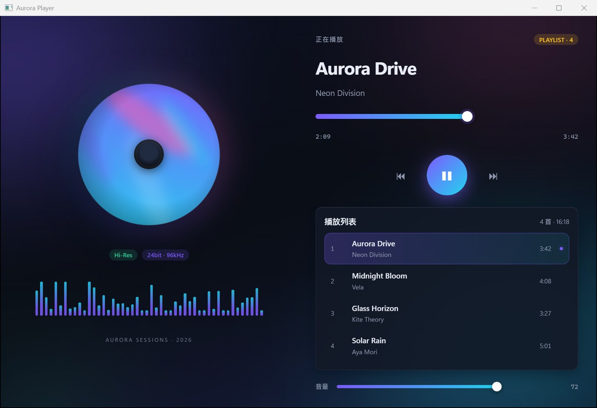
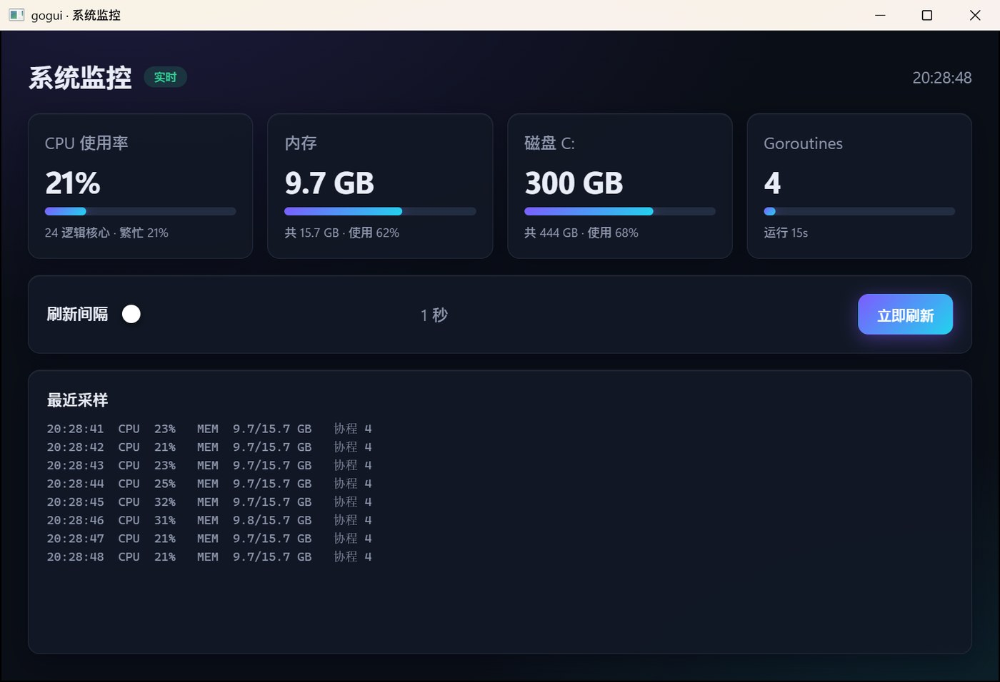
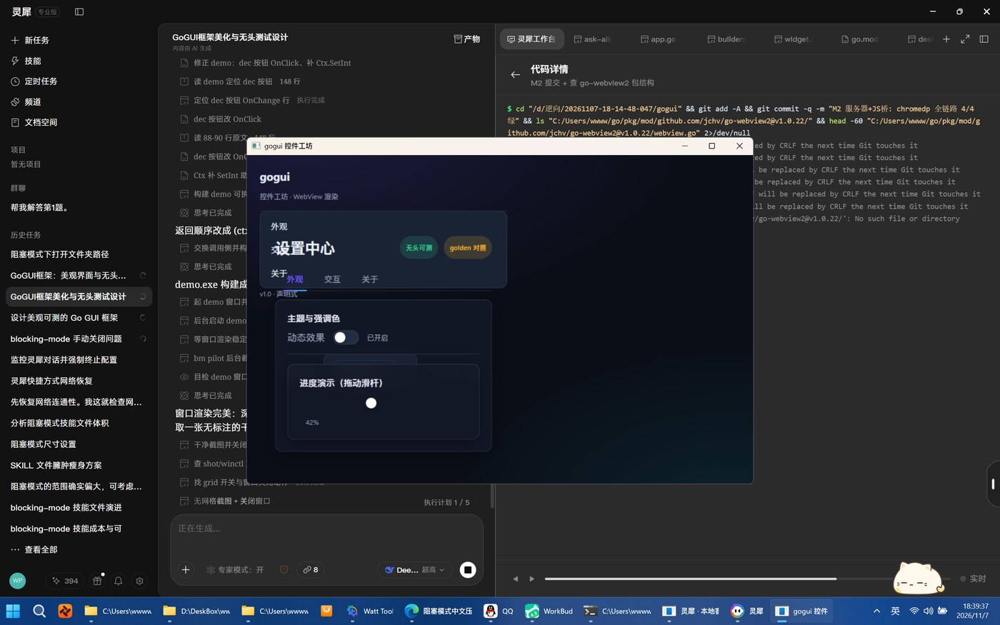

# gogui — 更美丽、更好测的声明式 Go GUI 框架

[](https://github.com/nimamasl114514/gogui/actions/workflows/ci.yml)
[](https://pkg.go.dev/github.com/nimamasl114514/gogui)
[](LICENSE)

> **Go 定义控件树 → WebView 渲染现代界面 → 无头操作控件做测试 → 像素/树快照双通道对照测试**



**gogui** 用纯 Go 描述界面，用系统自带的 WebView2/Chromium 渲染 HTML/CSS：
写的是 Go 结构体，得到的是现代设计系统，并且**每个控件都能在进程内无头驱动、每次渲染都能做像素级回归**。

gogui 的三条设计底线：

| 目标 | 实现 |
|---|---|
| **更美丽** | 控件树渲染为 HTML/CSS：系统字体、渐变强调色、玻璃拟态卡片、圆角阴影、hover/按下微动效；内置 `DarkGlow` / `CleanLight` 两套设计系统主题，全部样式只引用 CSS 变量，第三方可插拔扩展 |
| **无头可测** | 事件链路唯一入口 `App.Dispatch`：浏览器真实点击、进程内 harness 点击、Go 侧 `Update` 三条通道汇入同一条链路，**测试与真机不可能漂移**。`goguitest.Open(app)` 零浏览器、零窗口、毫秒级驱动控件 |
| **对照测试** | 双通道 golden：**像素级**（headless Chromium 固定视口截屏 vs 基线 PNG，逐像素对拍 + 红色高亮 diff 图）与**结构级**（控件树确定性文本快照 vs 基线），`gogui-golden` CLI 一键采集/校验 |

## 安装

```bash
go get github.com/nimamasl114514/gogui
```

环境要求见文末「环境要求」。

## 快速上手

```go
package main

import (
    "github.com/nimamasl114514/gogui"
    "github.com/nimamasl114514/gogui/theme"
)

func main() {
    app := gogui.New("设置", gogui.Size{W: 880, H: 600},
        gogui.VStack(
            gogui.Label("你好，gogui").Class("h1"),
            gogui.HStack(
                gogui.Button("＋1").Primary().WithID("inc").OnClick(func(c *gogui.Ctx) {
                    c.SetInt("count", c.Int("count")+1)
                }),
                gogui.Label("0").WithID("count").Class("strong"),
            ),
            gogui.Input().WithID("name").Placeholder("输入点什么…").OnChange(func(c *gogui.Ctx) {
                c.SetText("greet", "你好，"+c.Value("name"))
            }),
            gogui.Label("").WithID("greet").Class("muted"),
        ).Padding(24).Gap(16),
    )
    if err := gogui.Run(app, theme.DarkGlow(), gogui.Webview2()); err != nil {
        panic(err)
    }
}
```

三种窗口形态（`gogui.Run` 第三个参数）：

- `gogui.Webview2()` —— WebView2 原生窗口（Win10/11 默认，首选）
- `gogui.EdgeApp()` —— Edge/Chrome `--app` 窗口兜底
- `gogui.Headless()` —— 无窗口 serve（CI / 远程 / golden）

## 响应式绑定（推荐写法）

```go
count := gogui.NewVar(0)
name  := gogui.NewVar("")
ratio := gogui.NewVar(0.3)

app := gogui.New("绑定示例", gogui.Size{W: 640, H: 480},
    gogui.VStack(
        gogui.Label("").BindTextInt(count, func(n int) string { return fmt.Sprint(n) }),
        gogui.Button("+1").OnClick(func(c *gogui.Ctx) { count.Set(count.Get() + 1) }),
        gogui.Input().BindValue(name),                    // 双向：输入写回 name
        gogui.Label("").BindText(name),                   // 读方向：name → 文本
        gogui.Slider(0, 100).BindSlider(ratio),           // 双向
        gogui.Progress(0).BindLevel(ratio),               // 读方向
        gogui.Toggle().BindChecked(dark),                 // 双向
    ),
)
```

Var.Set 自动触发重渲染（事件窗口内合并排队，锁安全）。
派生文本用 `.BindFunc(func() string { ... })`；闭包里只被读取的 Var
请在 Build 后 `v.Attach(app)`（monitor 演示了 attachAll 写法）。

## v4 手感升级（少写一半样板）

```go
// ① 处理器不再强制 Ctx —— 按需取参
gogui.Button("＋").OnClick(func() { gogui.Inc(count) })            // 无参
gogui.Button("详情").OnClick(func(c *gogui.Ctx) { ... })          // 要上下文时
gogui.Toggle().OnChange(func(on bool) { ... })                    // 类型化取值
gogui.Slider(0, 100).OnChange(func(v float64) { ... })
gogui.Input().OnChange(func(text string) { ... })
gogui.Tabs(...).OnChange(func(idx int) { ... })

// ② 样式构造糖
gogui.H1("系统监控")        // = Label(...).Class("h1")；还有 H2/H3
gogui.Muted("说明")         // Small / Mono / Metric 同理
gogui.OkBadge("实时")       // WarnBadge / DangerBadge
gogui.Text(v.Clock).Muted() // 绑定文本也能直接点样式

// ③ Var 算子
gogui.Inc(count)                 // 自增
gogui.Add(ratio, 0.05)           // 累加（int/float64）
gogui.Flip(dark)                 // 翻转布尔
count.Update(func(n int) int { return n * 2 })

// ④ 布局短别名 + 表单行
gogui.Col(...) / gogui.Row(...)  // = VStack / HStack
gogui.Field("刷新间隔", slider)   // = Row(Muted(label), slider).Align("center")
```

完整对照见 `internal/monitorapp/monitor.go`（120 行树，全绑定零 SetText）。

## 无头操作控件（进程内，毫秒级）

```go
h := goguitest.Open(app)

h.Click("inc")                    // 模拟点击按钮
h.Type("name", "gogui")           // 模拟输入
h.Toggle("dark")                  // 模拟开关
h.Slide("opacity", 42)            // 模拟滑杆
h.ClickTabs("tabs", 1)            // 切页签
h.Choose("lang", "zh")            // 下拉选择

h.AssertText("count", "3")        // 状态断言
h.AssertValue("name", "gogui")
h.AssertChecked("dark", true)

snap := h.Snapshot()              // 控件树确定性快照
```

> 这些操作与浏览器里的真实鼠标/键盘**走同一条事件链路**（都汇入
> `App.Dispatch`），所以「测试通过」在结构上就意味着「真机可用」。

## 浏览器级全链路测试（chromedp）

```go
ctx, cancel := goguitest.NewBrowserContext(880, 600) // headless Chromium
defer cancel()
chromedp.Do(ctx,
    chromedp.Navigate(url),
    chromedp.Click(chromedp.CSS(`[data-gid="inc"]`)), // 真实鼠标点击
)
```

自动探测浏览器：`GOGUI_BROWSER` → Playwright Chromium → Edge → Chrome。

## 对照测试（golden）

基线库布局：

```
golden/
├── img/demo.png      # 像素基线（880×600 固定视口、冻结动画、字体就绪后截屏）
├── img/demo.json     # 采集环境 sidecar（浏览器/视口/容差/时间）
├── img/fail/         # 校验失败落盘：当前图 + 红色高亮 diff 图
└── tree/demo.txt     # 控件树快照基线（确定性缩进树）
```

CLI（对演示应用基线）：

```bash
go build -o tmp/gogui-golden.exe ./cmd/gogui-golden
tmp/gogui-golden.exe            # check：不一致退出码 1，可挂 CI
tmp/gogui-golden.exe -update    # 采集/刷新基线
```

Go 测试内（任意应用）：

```go
goguitest.AssertGoldenTree(t, "my-app", app)                          // 结构级
goguitest.AssertGoldenImage(t, "my-app", app, th, 880, 600, 0)       // 像素级（tol=0 逐像素）
```

`GOGUI_UPDATE=1`（或环境变量）→ 断言变为「写入基线」；`GOGUI_GOLDEN` 覆盖基线目录。

实测口径：两次独立 headless Chromium 会话对同一界面 **逐像素一致（tolerance=0）**；
改动 4 个汉字 → 像素 diff 477px / 528000px（0.090%）、maxDiff=216，diff 图红色高亮精确框住
文字变更区（见 `golden/img/fail/`）。

## 架构

```
model (纯 Go 控件树·单一事实源)
  └→ theme (设计系统→CSS 变量)
      └→ render (树→HTML+CSS，确定性输出)
          └→ server (本地 HTTP+SSE，事件回传，补丁下发)
              └→ window (Webview2 / EdgeApp / Headless)

testing:
  ├→ harness   进程内驱动（L1：零浏览器，毫秒级）
  ├→ chromedp  浏览器全链路（L2：真实 DOM 事件）
  └→ golden    像素 + 树快照双通道对照
```

- **单一事实源**：Go 控件树是唯一状态持有者；浏览器只是投影（keyed DOM morph
  只打差异补丁，焦点/光标/CSS 过渡全保留）。
- **确定性渲染**：同一树状态 + 同一主题 → 逐字节相同的 HTML；树快照确定性序列化。
- **零外部运行时依赖**：浏览器事件桥/补丁引擎无第三方 JS 依赖；WebView2Loader.dll
  已由 go-webview2 内嵌。
- Go 依赖仅 chromedp（CDP 客户端）与 jchv/go-webview2（WebView2 绑定）。

## 内置控件

VStack / HStack / Card / Spacer / Sep / Label / Button（primary·danger·ghost·secondary）/
Input / Textarea / Toggle / Slider / Progress / Select / Badge / Tabs / List / Image

排版级别：`.Class("h1"/"h2"/"h3"/"muted"/"small"/"strong"/"mono")`；徽标语义色：`.Class("ok"/"warn"/"danger")`。

## 运行演示

```bash
go run ./cmd/demo        # 真窗口（WebView2）
go run ./cmd/monitor     # 系统监控面板
go run ./cmd/player      # Aurora Player（showcase）
go test ./...            # 全量测试（模型/渲染/桥接/无头/golden）
```



## 高分屏与文字清晰度

- WebView2 后端在创建窗口前声明 `SetProcessDpiAwarenessContext(-4)`（per-monitor-v2），
  并按 DPI 缩放创建窗口 + AdjustWindowRect 精确客户区 —— **不做这两步，150% 缩放下文字必糊**；
- 设计系统不使用 `-webkit-font-smoothing:antialiased`（Windows 上会强制灰度抗锯齿、变虚）。

## v6 写代码（三条规则压成零条）

v5 还需记三件事：记得 `AttachAll`、记得「占位值 + Bind」两段式、记得字符串枚举拼对。
v6 用**依赖自动追踪（reactivity）**把三者从调用侧抹掉：`BindFunc`/`XxxFunc` 注册时把闭包求值一次，
期间所有 `Var.Get()` 自动向当前控件登记依赖；控件直接接 `*Var` 时内部即 `Attach`。

```go
// 构造即绑定（无占位值、无 AttachAll）
gogui.Metric(&v.MemUsed, "%.1f GB")
gogui.Text(&v.Clock)
gogui.TextFloat(&v.Interval, "%.0f 秒")
gogui.Progress(&v.CPU)                 // 以前 Progress(0).BindLevel(&v.CPU)
gogui.Slider(1, 10, &v.Interval)       // 以前 Slider(1,10).BindSlider(...)

// 复合文本 → XxxFunc（闭包读到的 Var 自动挂）
gogui.MetricFunc(func() string { return fmt.Sprintf("运行 %s", v.Uptime.Get()) })
gogui.SmallFunc(func() string { return "运行 " + v.Uptime.Get() })

// 布局常量（类型别名，旧字符串写法照常可用）
.Align(gogui.Center)   // 或 Align("center")
.Gap(gogui.SM)         // XS/SM/MD/LG/XL（4/8/14/18/26）
.Padding(gogui.LG)
```

**自动追踪的边界**（reactivity 经典限制，已写进文档）：构建时未走到的分支里读到的 Var 不会被收集——

```go
gogui.TextFunc(func() string {
    if flag { return v.Name.Get() }   // flag=false 时盲区
    return "—"
}).Depends(&v.Name)                   // 逃生舱：显式补依赖
```

v6 之后 monitorapp 的 `Build` 尾部没有挂载步骤，`Metric/Progress/SmallFunc` 全部一段式完成；
调用侧心智模型收敛为一句：**写树，挂 Var，闭包里随便读**。

## v5 写代码（再减负）

```go
// ① 状态容器零样板：Var 值字段，零值可用，AttachAll 一次挂全
type Vars struct {
    CPU   gogui.FloatVar
    Clock gogui.StringVar
}
v := &Vars{}                 // 不需要 NewVars
gogui.AttachAll(app, v)      // 反射挂载全部 Var（直接 Bind* 的已自动挂载）

// ② 格式串绑定（fmt.Sprintf 闭包退场）
gogui.TextFloat(&v.MemUsed, "%.1f GB")
gogui.TextInt(&v.Count, "%d 个")
gogui.Text(&v.Clock)                    // 纯文本
gogui.TextPct(&v.CPU)                   // 0..1 → "42%"
gogui.TextF(&v.Name, "你好，%s")

// ③ Style 逃生舱（class 覆盖不到时直接写 CSS）
gogui.H1("标题").Style("letter-spacing:2px;text-transform:uppercase")
```

效果（monitorapp 实测）：状态容器样板从 44 行降到 15 行（**-66%**），
整个控件树 107 → 90 行；「写一个 app」现在 = 一个 Vars 结构体 + 一棵树 + AttachAll 三件事。

## 极限美丽：Aurora Player（showcase）

`cmd/player` —— 全 SVG 生成专辑艺术（零素材资产）+ 极光背景 + 旋转碟片 + CSS 频谱 +
60fps 播放头（`StartFrames` 驱动 Var → Slider 平滑推进）。四曲四套渐变、播放/暂停/切歌/
拖拽进度/列表点播/音量全通。为此新增三个框架能力：`theme.ExtraCSS`（应用级外挂样式）、
`Ctx.SetProp` + `Ctx.AddClass/RemoveClass`（运行期换图/切动画状态）、`SVGImage`（SVG→data-URI）。
另支持「可点击容器」：任何注册了 `onClick` 的控件（含 Card/Row 行）都会被事件桥命中。

**动态验收（gogui-motion）—— 静态截图对动态 GUI 是失明的**：

```bash
gogui-motion -cdp -url http://127.0.0.1:PORT -frames 12 -interval 120 -warmup 3 \
    -out shots/motion/x -expect-motion disc,viz,seek      # 该动的地方必须动
gogui-motion ... -expect-static disc:4,viz:1,seek:8       # 该静的地方必须静（name:thresh 按噪声底覆盖）
```

- 连拍帧 → 按 `/gg/layout` 控件矩形分区 → 相邻帧平均通道差 → 期望判定；
- 产出 contact-sheet（连拍表）+ motion-heat（运动热图）+ report.json；退出码可进 CI；
- `-cdp` 模式用 headless Chromium 直采（ROI 零偏移、不受真人点击干扰、可直接进 CI）；
  真窗模式需要外部截图助手：设置 `GOGUI_CAPTURE_BIN` 指向实现了 `windows` / `shot` 子命令的截图程序；
- 静默守卫：拍摄期间检测到输入事件自动重拍，杜绝「人点着窗口测静态」的假数据。

Aurora Player 实测（CDP 模式，12 帧 × 120ms）：

| 状态 | disc | viz | seek | 判定 |
|---|---|---|---|---|
| 暂停（初态） | 0.06 | 0.00 | 0.05 | 静止 PASS |
| 播放中 | 2.53 | 24.91 | 2.61 | 运动 PASS |
| 再暂停 | 0.07 | 0.00 | 0.05 | 静止 PASS |

**它抓到的两个真动态 bug**：① 初始状态碟片就在转（暂停态应为静止）→ 初态补 `paused` 类；
② 本机 WebView2 把 `prefers-reduced-motion` 报成 reduce，内置设计系统把**全部动画压到 0.01ms（等于全灭）**
→ 新增 `theme.ForceAnimations`，reduce 规则作用域收窄到未强制动画的应用（getComputedStyle 指纹
`viz|0.82s|running` 为证）。

## 质量审计：37 项发现与修复

对 model / render / server / tests-and-apps 四个层面做了一轮系统审计，产出 37 项分级发现，
其中修复的 **P0 级**：

| 发现 | 修复 |
|---|---|
| Dispatch 早退路径泄漏事件窗口（根 nil / 控件不存在 → 后续通知永久被吞） | 早退也 `finishEvent(false)` + 回归用例 |
| Update 内 panic 写锁泄漏 → 进程级死锁（且 panic 被吞） | `defer unlockTree` 先于 `endEvent` + recover 记录失败 |
| 处理器内重入 App 只读入口 → RWMutex 自死锁（静默挂 5 分钟） | goroutine 编号守卫：立即 panic 带指引（fail-fast） |
| 公开读方法裸读 Props → 与 Dispatch 并发触发 map 并发读写 fatal | App.ResolveText/Value/Checked/Level 持读锁入口；harness 断言全部切换 |
| Style/Align/Justify/主题变量四处未转义 → WebView 内属性/style 注入 | 转义 + 枚举白名单 + CSS 变量词法净化 |
| Select 双类名（双边框/箭头错位）、data-gid 重复、Tabs/List `OnClick(func(int))` 永不触发、自动 ID 撞显式 ID、Add 自环栈溢出、notify 重入递归 | 全部修复并加回归用例 |

同时按审计建议修复：SSE 写超时 + last-chunk + Close 强制断开活跃连接（goroutine 泄漏）、
每事件双渲染（补丁复用减半）、bridge 全局输入 timer 跨控件吞字（改每控件独立）、
重试仅限网络层（防 click 双触发）、Content-Length 严格解析（400/411）、Host/Origin/Content-Type
护栏（421/403/415，防 DNS rebinding 与跨站驱动）、layout 并发 409、日志字段截断、trace 字段名漂移修死。

> 环境注记：压测中发现某些 Windows 环境的 loopback 在连接 churn 下偶发 SYN 超时（干净树同样复现，
> 属环境而非框架），已用「桥脚本内联 + EventSource onopen 全量对齐 + 测试导航重试」三层吸收。

## 测试矩阵 & 60fps

**测试规模（实测全绿，`go test ./... -count=2`）**：model 26 例（含 2 个常驻 fuzz 种子目标、并发锤击
4000 ops × 3、帧驱动回归）+ render 5 + server 12（60fps/10 连击/双 SSE 客户端/可观测性/布局/fuzz 种子）
+ testing golden。

**模糊测试（go fuzz，短跑累计 ~40 万 execs）**：`FuzzDispatch`（随机事件轰炸）、
`FuzzRenderTree`（随机树→确定性+转义+UTF-8 合法）、`FuzzServeConnBytes`（任意字节灌迷你 HTTP）、
`FuzzParseRequestLine` / `FuzzParseQuery`。

**「显示值 = 数据源」断言层（新增）**：`internal/monitorapp/monitor_test.go` 把监控面板的
每个数值文本与数据源逐项对账（0.37 → "37%"、8.8GB → "8.8 GB"、副行"繁忙 37%"），
专防「大字 0% 但副行 37%」这类**语义口径 bug**（golden/布局测试都覆盖不到）。
同时修复了 harness 断言绕过绑定解析的问题（AssertText/AssertValue/AssertChecked/AssertLevel 统一走解析值）。

**fuzz/压测发现并修复的真实 bug**：

| # | bug | 触发 | 修复 |
|---|---|---|---|
| 1 | 并发 Dispatch 事件窗口串旗 → 处理器内 Set 误走 notify → 自持写锁取读锁**自死锁** | 并发锤击（4000 ops） | `inEvent bool` → `eventDepth int` 嵌套计数 |
| 2 | Batch/Update 内 panic 泄漏事件窗口 → 之后所有通知被吞 | 帧驱动 panic 用例 | `defer endEvent()` + 回归用例 |
| 3 | 非法 UTF-8 字节原样进入 HTML 输出 | FuzzRenderTree | `writeEscaped` 净化 U+FFFD + class 属性转义 |
| 4 | 迷你 HTTP 请求行/头无长度上限（可 OOM） | 代码审计 | `readLine` 8KB 限长 + 头数上限 100 |
| 5 | 请求行解析过松（任意方法字符/无 `/` 路径） | FuzzParseRequestLine | 严格校验大写方法 token / `/` 前缀 / HTTP/1.x |

**60fps（`App.StartFrames(60, fn)`）实测**：帧驱动每帧一次批量渲染+SSE 推送；浏览器端
2 秒收到补丁 **120/120 帧（零丢帧）**、rAF **121 帧**、单帧渲染峰值 **186µs**
（16.6ms 预算的 1.1%）。回归阈值 ≥90 帧（并行 CI 噪声下不误报）。

```go
stop := app.StartFrames(60, func(dt time.Duration) {
    phase += dt.Seconds()
    v.Progress.Set(0.5 + 0.5*math.Sin(phase*2*math.Pi)) // 每帧一次渲染推送
})
defer stop()
```

## 开发循环（gogui-dev 热重载）

```bash
go build -o tmp/gogui-dev.exe ./cmd/gogui-dev
./tmp/gogui-dev.exe -target ./cmd/monitor
```

- 轮询 `*.go`（300ms + 200ms 防抖）→ 自动 `go build` → 杀旧进程启新进程；
- **编译失败保留旧窗口**并在终端打印 go 原始错误（不打断手上调试）；
- 子进程 stdout 直通（server URL 照常打印，inspect/curl 无缝衔接）；
- 实测（本机）：编辑保存 → 新界面可见 **≈1.1s**（300ms 轮询 + 200ms 防抖 + 620ms 构建）；
  连续 5 轮：初次构建 523ms / 改文案 637ms / 还原 620ms / 语法错误 387ms 保窗存活 / 修复 619ms 自动恢复。

## 可观测性（不截图就知道是否正常）

应用启动即打印 server URL（`gogui: server listening on http://127.0.0.1:PORT`），
四个运行时端点 + 检查器 CLI，语义/性能/错误全可查询：

| 端点 | 内容 |
|---|---|
| `GET /gg/state` | 全量 JSON：版本、uptime、控件数、事件计数（total/failed）、渲染计数与 last/max 耗时、JS 错误数、SSE 客户端/推送数、协程、堆、最近事件、最近日志；`?tree=1` 附控件树快照 |
| `GET /gg/health` | 健康判定（200 ok / 503）；返回事件/失败/JS错误/渲染耗时等关键计数 |
| `GET /gg/metrics` | Prometheus 文本口径（`gogui_events_total` / `gogui_render_max_us` / `gogui_js_errors_total` …） |
| `GET /gg/log?n=N` | 最近 N 条事件 + 前端错误环形缓冲（256 条） |
| `POST /gg/log` | 前端错误回流入口（bridge 自动上报，见下） |
| `GET /gg/layout` | **控件盒模型 + 计算样式**：gid/tag/宽高/坐标/字号/字重/文字色/背景/圆角/可见性（SSE 命令→JS 采集→回传，2s 超时；`?cached=1` 取上次结果） |
| `GET /gg/trace?n=N` | **端到端事件追踪**：每条事件 id/控件/类型/dispatch_us/render_ns/patch_bytes + 前端回填 rtt_us/morph_us（JS 在 morph 完成后上报） |
| `POST /gg/perf` | 前端耗时回填入口（bridge 自动） |
| `GET /gg/history?n=N` | **1Hz 历史曲线**（300 点 = 5 分钟）：events/renders 增量、render_ns、heap_kb、goroutines |
| `GET /gg/widget/<gid>` | **单控件透视**：模型属性 + 绑定解析值 + 缓存布局盒模型 |

**前端错误回流**：bridge 内置 `window.onerror` / `unhandledrejection` / fetch 失败上报——
页面脚本崩了不用开 DevTools，`/gg/state` 的 `js_errors_total` 与 `/gg/log` 直接可见。

检查器 CLI（已入工具箱）：

```bash
gogui-inspect -url http://127.0.0.1:22397 state    # 人读全量状态
gogui-inspect -url ... health                     # 退出码 0/1，可挂脚本
gogui-inspect -url ... metrics                    # 喂监控系统
gogui-inspect -url ... log -n 50                  # 事件黑匣子
gogui-inspect -url ... layout                     # 控件尺寸/样式表（异常自动 ⚠ 标红）
gogui-inspect -url ... trace -n 20                # 端到端事件追踪（含 morph/rtt）
gogui-inspect -url ... widget button-1            # 单控件透视（属性/解析值/布局）
gogui-inspect -url ... history -n 60              # 历史曲线（ASCII 迷你图）
gogui-inspect -url ... watch                      # 实时迷你图（ev/s、渲染耗时、堆）
```

实测追踪（真实点击「立即刷新」按钮）：

```
  id     时间           控件        事件    go耗时us  渲染us   补丁B  rtt/morph  状态
  t1     20:54:56.556  button-1    click        0    11.1   3849  2400/300     ✓
已回填 1/1 · 平均 rtt=2400us morph=300us
```

其它系统级能力：

- **panic 防护**：事件处理器 panic 被 recover（failed 事件 + 栈日志，进程不死，`/gg/log` 可见）；
- **健康不变量**：`/gg/health` 返回 warnings[]（处理器失败/JS 错误/渲染超 50ms 预算/无客户端）；
- **启动时序**：`/gg/state` 的 `startup` 段 = 首客户端连接 / 首次渲染 / 首事件的毫秒偏移；
- **高精度计时**：渲染与追踪耗时走 Windows QPC（`time.Since` 在微秒级有量化毛刺，实测会出 0ns/15ms 假值）；
- `gogui-inspect watch` 示例：`ev/s · rnd/s · 渲染耗时迷你图 · 堆迷你图 · 协程 · JS错误 · 最近事件` 一行一帧。

`layout` 实测（监控应用 37 个控件，全部达标）：

```
viewport 980×640   采集于 20:43:59   控件 38 个
  gid                tag         尺寸(w×h)    位置(x,y)  字号      文字色         边框圆角
  label-1            div         102×39        26,26     26px    rgb(233,237,248)  0px
  card-1             div         222×143       26,81     16px    rgb(233,237,248)  12px
  slider-1           input       280×6        119,276  13.3px   rgb(255,255,255) 999px
  button-1           button       93×40       842,259  14px     rgb(255,255,255)  10px
  ...
✓ 布局与样式未见异常（交互控件尺寸正常、无越界、字号达标）
```

异常判定（CLI 内置）：交互控件尺寸 <8px（滑杆按 轨长<80/盒高<4 另判）、
超出视口、字号 <10px 均标 ⚠ 并汇总——**「控件是不是正常大小/正常样式」变成一条命令的输出**。

实测输出（监控应用运行 15s，期间有真实交互）：

```
gogui v1.2.0 · gogui · 系统监控
  server   http://127.0.0.1:24688  uptime=10.4s  sse_clients=1  sse_pushes=57
  widgets  37   goroutines=5   heap=1784 KB
  events   total=53 failed=0   renders=112   render_last=0us render_max=1507us
  js_errors 0
  last_event slider-1 ← input(10)  5554ms 前
```

> 有了它，「GUI 是不是正常」= `events_total` 在涨、`failed=0`、`js_errors=0`、
> `render_max_us` 在预期内——一切是数字，不再是截图。

## 性能 / 体积 / 内存（实测）

### 二进制体积

| 构建 | demo.exe | 说明 |
|---|---|---|
| `go build`（裸） | **10.5 MB** | 含 DWARF/符号表 |
| `go build -trimpath -ldflags "-s -w"` | **3.8 MB** | `build.ps1` / `build.sh` 默认 |

体积构成与取舍（全部实测，`go tool nm -size` 聚合）：
- **去掉 net/http 是最大一刀**：手写微型 HTTP/1.1（`server/serve.go`，约 380 行）替掉 net/http+crypto，
  7.2MB → 3.8MB（**-47%**），同时消灭 `crypto/internal/fips140` 的 30MB+ BSS 虚拟内存；
- 剩余主体是 Go runtime（~2.0MB）+ 我们的全部代码（含 WebView2Loader.dll 内嵌 134KB）；
- 边界（有意为之）：只服务 127.0.0.1 单客户端 bridge，不支持 TLS/HTTP2/chunked 请求体/keep-alive。

### 渲染性能（`go test ./render/ -bench .`）

| 场景 | 优化前 | 优化后 | 提升 |
|---|---|---|---|
| 24 控件（small） | 250 µs / 453 allocs | **4.3 µs / 23 allocs** | 58× |
| 240 控件（medium） | 4.44 ms / 5705 allocs | **85 µs / 285 allocs** | 52× |
| 1200 控件（large） | 28.5 ms / 28399 allocs | **338 µs / 1405 allocs** | 84× |
| HTML 转义（单个文本） | 6.2 µs / 9 allocs | **0.11 µs / 1 alloc** | 57× |

优化手段：转义改零分配直写 `strings.Builder`（弃 `strings.Replacer`）、容量一次预估 `Grow`、
数值格式化走 `strconv.AppendFloat`（弃 `fmt.Sprintf`）。含义：**每次输入按键的全树重渲染 < 0.1ms**，
实时数据面板按秒刷新毫无压力。

事件链路：`Dispatch` 单击 76 ns（1 alloc）、`Var.Set` 31 ns（0 alloc）。

### 内存（tasklist / runtime.MemStats 实测）

| 口径 | 数值 |
|---|---|
| 框架本体（树 + server + 10 次全量渲染后 GC） | **HeapAlloc 555 KB** · HeapSys 7.8 MB · 协程 2 个 |
| 框架进程 Working Set（无窗口） | **12.3 MB** |
| + WebView2 窗口（Chromium 宿主内组件） | 31.9 MB 总 WS（WebView 引擎本体另计，Edge/WebView2 子进程群属于 Chromium 运行时） |

对比参照：Electron 同类应用典型 120-200MB RSS + 150MB+ 安装体。

## 环境要求

- Go ≥ 1.27；Windows 10/11（窗口后端；model/render/server/testing 全平台可用）
- 像素 golden 需要 Chromium 内核浏览器（自动探测 Playwright 缓存 / Edge / Chrome，也可用 `GOGUI_BROWSER` 指定）
- WebView2 运行时（Win10/11 自带；缺失时用 `gogui.EdgeApp()` 兜底）

## 截图



- `docs/demo.jpg` —— WebView2 原生窗口实拍（控件工坊）
- `docs/monitor.jpg` —— 系统监控面板（`cmd/monitor`）
- `docs/player.jpg` —— Aurora Player（`cmd/player`）
- `golden/img/demo.png` —— headless 渲染基线（与真窗同一套渲染链路）

## 跨机 golden

像素基线受字体栈影响，跨机器/跨 Chromium 版本不保证逐字节一致。两种做法：

- 每台机器各自 `gogui-golden -update` 采集基线（默认）；
- CI 只跑树快照与行为断言，像素对照用 `GOGUI_SKIP_IMAGE=1` 显式跳过。

## 许可证

[MIT](LICENSE) © 2026 nimamasl114514
